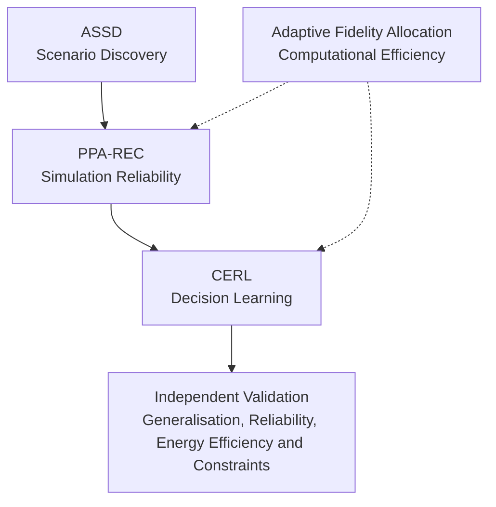

# Research and Patent Potential

## 1. Objective

I aim to extend the Solar EV PMU Strategist beyond its current simulation and decision-making capabilities through research into physics-aware simulation, energy-management learning, scenario discovery and computationally efficient modelling.

The future work will focus on identifying technically meaningful problems, developing distinct mechanisms and validating their performance through controlled simulation experiments. Potential patent directions will be considered only where a specific technical contribution can be distinguished from existing work.

The proposed directions will be assessed against five criteria:

- **Research potential:** Whether the work can answer a meaningful scientific question.
- **Patent potential:** Whether it may lead to a specific and protectable technical mechanism.
- **Technical value:** Whether it addresses a significant limitation or capability gap.
- **Feasibility:** Whether it can be implemented and evaluated within the simulation.
- **Differentiation:** Whether the proposed mechanism offers a defensible contribution beyond established approaches.

---

## 2. Proposed Research Directions

### 2.1 Physics-Preserving Adaptive Simulation Error Compensation (PPA-REC)

**Priority: Principal research direction**

I intend to investigate a hybrid physics–AI simulation approach that identifies unreliable physics-based predictions and selectively corrects them using learned discrepancy models, while maintaining physical consistency.

**Proposed approach**

1. Generate baseline state predictions using the physics-based simulator.
2. Estimate prediction discrepancy and uncertainty for relevant physical subsystems.
3. Use a learned residual model to propose corrections to selected state variables.
4. Assess whether each correction is reliable under the current operating conditions.
5. Enforce applicable physical constraints on accepted corrections, including energy consistency, thermal bounds and vehicle-dynamics constraints.
6. Reject unreliable or physically inadmissible corrections and fall back to the baseline physics prediction.
7. Evaluate the effect of corrected predictions on downstream control decisions, not only on prediction accuracy.

**Research questions**

- Can the simulator identify which physical predictions become unreliable under changing operating conditions?
- Does uncertainty-aware correction with physical admissibility enforcement outperform conventional residual learning?
- Do improved state predictions lead to better downstream control decisions?
- How does the method perform under unseen conditions and distribution shift?

**Evaluation plan**

I plan to compare:

- The baseline physics simulator.
- Unconstrained residual correction.
- Physics-informed residual correction.
- Uncertainty-aware, constraint-preserving correction with fallback.

Evaluation metrics will include prediction error, physical-constraint violations, uncertainty calibration, downstream decision quality, robustness under distribution shift and computational overhead.

**Potential research and patent direction**

The potential contribution is a subsystem-aware correction mechanism combining discrepancy estimation, correction uncertainty, physical admissibility checks and selective fallback to physics-based predictions. The novelty would need to reside in the specific integrated mechanism and its demonstrated technical effect.

---

### 2.2 Counterfactual Energy-Regret Learning (CERL)

**Priority: Principal research direction**

I intend to investigate whether evaluating feasible alternative actions through physics-based simulation rollouts can provide a more informative learning signal for solar-EV energy management than conventional reward-based learning alone.

**Proposed approach**

1. Generate feasible alternative control actions at a decision point.
2. Evaluate their future outcomes through constrained physics-based simulation rollouts.
3. Compare the selected action with the best feasible alternative over a defined horizon.
4. Calculate a counterfactual regret signal representing the energy consequences of the decision.
5. Incorporate this signal into policy optimisation alongside task-completion and operating constraints.
6. Investigate computationally efficient alternative generation, rollout selection and horizon management.

**Multi-objective extension**

I will investigate extending the regret representation to account for multiple objectives:

- Energy consumption.
- Solar-energy utilisation.
- Battery thermal stress.
- Battery degradation proxies, if supported by the simulator.
- Task completion and constraint satisfaction.

Constrained or Pareto-based policy optimisation may be used to study trade-offs. This will be treated as an extension of CERL rather than a separate innovation unless a distinct technical mechanism is established.

**Research questions**

- Do constrained counterfactual rollouts provide a better learning signal than conventional reward-only reinforcement learning?
- Does regret-based learning reduce short-sighted energy decisions?
- How should feasible alternatives and rollout horizons be selected?
- Does vector-valued regret improve trade-off management compared with scalar reward formulations?
- Can computational cost be reduced without losing decision quality?

**Evaluation plan**

I plan to compare reward-only reinforcement learning, model-predictive control, relevant energy-management baselines and CERL. Metrics will include energy consumption, solar-energy utilisation, task completion, constraint violations, regret, sample efficiency, Pareto performance and runtime.

**Potential research and patent direction**

The potential contribution is a feasible-alternative generation and counterfactual regret-optimisation mechanism tailored to physics-based solar-EV decision-making. Novelty would need to come from the specific regret formulation, alternative-generation strategy, computational method or policy-optimisation mechanism—not merely from applying regret minimisation to an EV simulator.

---

### 2.3 Adversarial Solar-Scenario Discovery (ASSD)

**Priority: Major supporting research direction**

I intend to investigate automated discovery of diverse, physically plausible environmental and operating scenarios that expose weaknesses in the simulator and its learned controllers.

**Proposed approach**

1. Define scenario variables such as irradiance, ambient temperature, initial battery state, propulsion demand and other supported operating conditions.
2. Define physical and statistical constraints to exclude implausible combinations.
3. Search the constrained scenario space using adversarial optimisation or quality-diversity methods.
4. Score scenarios using multiple signals:
   - Policy failure or degraded task performance.
   - Simulator prediction uncertainty or discrepancy.
   - Constraint violations.
   - Novelty relative to previously discovered scenarios.
5. Preserve a diverse set of high-value scenarios rather than only a single worst-case example.
6. Use discovered scenarios for targeted training while maintaining separate held-out scenarios for robustness evaluation.

**Research questions**

- Does guided discovery find more informative failures than random scenario generation or parameter sweeps?
- Can the method expose interacting causes missed by one-factor-at-a-time testing?
- Does considering both model uncertainty and policy failure reveal scenarios that either signal alone misses?
- Do policies trained on discovered scenarios generalise to unseen stress conditions?

**Evaluation plan**

I plan to compare random sampling, structured parameter sweeps and constrained adversarial or quality-diversity search. Metrics will include failure discovery rate, scenario diversity, physical plausibility, novelty, generalisation and search cost. Training and evaluation scenario sets will remain separate.

**Potential research and patent direction**

The potential contribution is a physically constrained, diversity-preserving scenario-discovery mechanism that jointly considers simulator uncertainty, controller failure and scenario novelty for coupled solar-EV conditions.

---

### 2.4 Physics-Discrepancy-Aware Simulation Fidelity Allocation

**Priority: Independent simulation research direction**

I intend to investigate whether computational effort can be allocated dynamically to the physical subsystems whose accuracy matters most to the current simulation state or control decision.

**Proposed approach**

1. Divide the simulator into supported physical subsystems, such as solar generation, battery behaviour, thermal dynamics, aerodynamics and propulsion.
2. Estimate prediction discrepancy and uncertainty for each subsystem.
3. Estimate how each subsystem's uncertainty propagates into important system states and control decisions.
4. Allocate higher-fidelity computation to subsystems with high uncertainty and high downstream influence.
5. Use lower-cost approximations for subsystems where additional fidelity is unlikely to change the outcome or decision.
6. Reassess the allocation as conditions and operating regimes change.

**Research questions**

- Can adaptive fidelity achieve comparable decision quality to uniformly high-fidelity simulation at lower computational cost?
- Does decision-sensitive allocation outperform allocation based only on prediction error?
- Which uncertainty and sensitivity measures are most useful for allocating fidelity?
- How does the method behave when several subsystems become uncertain simultaneously?

**Evaluation plan**

I plan to compare fixed low-fidelity, fixed high-fidelity and adaptive-fidelity simulation. Metrics will include state-prediction error, control-decision quality, constraint violations, runtime and computational cost.

**Potential research and patent direction**

The potential contribution is a dynamic subsystem-level fidelity allocator driven jointly by prediction discrepancy, uncertainty propagation and sensitivity of downstream control decisions.

---

### 2.5 Uncertainty-Triggered Policy Switching

**Priority: Secondary research direction; requires further differentiation**

I intend to investigate a control architecture that detects when a learned policy is operating outside its reliable experience and switches to a validated fallback controller.

**Proposed approach**

1. Estimate uncertainty in the learned policy's predicted outcomes.
2. Detect distribution shift relative to the training conditions.
3. Assess the current state against a validated operating envelope.
4. Include relevant energy-reserve and predicted constraint-violation information in the switching decision.
5. Switch to a conservative fallback controller when defined reliability conditions are exceeded.
6. Define recovery conditions and hysteresis to avoid unstable or excessive switching.

**Research questions**

- Does combining policy uncertainty, distribution shift and energy reserve improve switching decisions?
- Can the mechanism reduce failures without excessive fallback activation?
- How reliably can the system determine when it is appropriate to return to the learned policy?

**Evaluation plan**

Metrics will include task completion, energy efficiency, constraint violations, false triggers, missed failure conditions, switching frequency and recovery behaviour under held-out distribution shifts.

**Potential research and patent direction**

A possible contribution is a policy-arbitration mechanism combining calibrated uncertainty, operating-envelope assessment, energy reserve and controlled switching/recovery. Existing uncertainty-based fallback methods will need to be examined carefully as prior art.

---

### 2.6 Solar-EV Energy Viability Learning

**Priority: Secondary research direction**

I intend to investigate whether a model can estimate if successful completion of the remaining task is still feasible from the current operating state.

Battery charge alone may not represent journey feasibility. Two vehicles with identical battery charge may have different remaining distances, solar forecasts, terrain, thermal conditions and expected propulsion requirements.

**Proposed approach**

1. Define terminal success conditions and relevant energy and operating constraints.
2. Generate simulated trajectories across initial battery states, solar conditions, task demands and other supported variables.
3. Estimate whether each state can reach a successful terminal condition.
4. Learn an uncertainty-aware viability function or boundary over the relevant state variables.
5. Use the estimated boundary to identify actions likely to leave the feasible operating region.
6. Evaluate conservative handling of states close to, or uncertain relative to, the learned boundary.

**Research questions**

- Can a learned viability estimate outperform fixed battery thresholds?
- Does viability-aware control reduce energy-related task failures?
- How well does the learned boundary generalise to unseen conditions?
- Can uncertainty near the boundary be quantified sufficiently to avoid false-safe predictions?

**Evaluation plan**

I plan to compare fixed-threshold control, unconstrained reinforcement learning and viability-aware control. Metrics will include task completion, energy use, constraint violations, false-safe predictions, calibration and generalisation.

**Potential research and patent direction**

A possible contribution is an uncertainty-aware learned viability representation for task completion under coupled solar-generation, battery and vehicle-demand constraints.

---

### 2.7 Causal Failure Attribution for Solar-EV Simulation

**Priority: Research and diagnostic direction**

I intend to investigate methods for identifying environmental, physical and control factors that contribute to simulation failures, including interactions between multiple factors.

**Proposed approach**

1. Detect and classify a failure or degraded outcome.
2. Generate matched counterfactual simulations by intervening on selected factors while holding other conditions constant.
3. Estimate individual factor contributions and interactions.
4. Distinguish direct and mediated effects where the simulator supports such analysis.
5. Produce a ranked attribution supported by counterfactual evidence.

For example, a journey failure could involve reduced solar generation, excessive propulsion demand, poor control decisions, thermal restrictions or simulation prediction errors.

**Research questions**

- Does intervention-based attribution identify failure causes more reliably than correlation-based feature importance?
- Can it distinguish interacting causes, such as reduced solar generation combined with increased propulsion demand?
- Are attributions stable across repeated runs and operating conditions?

**Evaluation plan**

I plan to use controlled interventions with known causes. Metrics will include attribution accuracy, interaction detection, stability, reproducibility and computational cost.

**Potential research direction**

The initial contribution may be a counterfactual diagnostic and evaluation framework for explaining failures in coupled solar-EV simulations. Its value will be assessed primarily as a research contribution and debugging tool.

---

## 3. Research Prioritisation

| Priority | Research direction | Planned action |
|---:|---|---|
| 1 | PPA-REC | Develop as the primary simulation-reliability contribution |
| 2 | CERL | Develop independently as the primary decision-learning contribution |
| 3 | ASSD | Develop as a scenario-discovery and robustness-testing framework |
| 4 | Adaptive Simulation Fidelity Allocation | Investigate as an independent simulation-efficiency contribution |
| 5 | Energy Viability Learning | Build a research prototype if the simulator supports the required state and task definitions |
| 6 | Uncertainty-Triggered Policy Switching | Pursue only if a differentiated arbitration mechanism can be established |
| 7 | Causal Failure Attribution | Develop primarily as a research and diagnostic contribution |

Multi-objective counterfactual regret learning will initially be investigated as an extension of CERL, not as a separate proposal.

---

## 4. Integrated Research Architecture

The principal directions may be investigated as a connected architecture while retaining independent experiments for each contribution.

| Component | Intended role |
|---|---|
| **ASSD** | Discover diverse, physically plausible scenarios that challenge the simulator and controller. |
| **PPA-REC** | Investigate and improve the reliability of physics-based predictions under those scenarios. |
| **CERL** | Use constrained counterfactual outcomes to improve energy-management decisions. |
| **Adaptive Fidelity Allocation** | Investigate how to allocate simulation effort where it has the greatest effect on prediction and decision quality. |
| **Independent Validation** | Evaluate each contribution separately and then assess the integrated architecture. |

Integration will be considered only after the individual components have been independently implemented and evaluated. Combining existing methods will not, by itself, be treated as evidence of novelty.

---

## 5. Validation Strategy

Before drawing conclusions about research value or patent potential, I plan to complete the following steps.

### 5.1 Repository Audit

- Identify the capabilities already implemented in `solar-ev-env`.
- Map each proposed direction to the relevant simulation components.
- Identify existing functionality that may overlap with a proposal.
- Confirm that the required state variables, physical models and evaluation outputs are available.
- Refine or remove proposals that cannot be supported by the current simulator without disproportionate redevelopment.

### 5.2 Academic Prior-Art Review

Review relevant literature in:

- Physics-informed and hybrid modelling.
- Residual learning and uncertainty estimation.
- Counterfactual reinforcement learning and regret minimisation.
- Adversarial and quality-diversity scenario generation.
- Adaptive-fidelity and multi-fidelity simulation.
- Safe reinforcement learning and viability theory.
- Causal inference and counterfactual diagnosis.

### 5.3 Patent Prior-Art Review

For each potential invention:

- Identify the closest existing patent documents and claims.
- Compare the proposed mechanism with the identified prior art.
- Define the precise technical difference.
- Determine whether the difference can be demonstrated experimentally.
- Seek a jurisdiction-specific assessment from a qualified patent professional before filing.

### 5.4 Experimental Validation

- Establish reproducible baselines.
- Define controlled training, validation and held-out test scenarios.
- Use ablation studies to identify which parts of each proposed mechanism contribute to performance.
- Report accuracy, robustness, computational cost and relevant physical-constraint violations.
- Avoid evaluating a method only on scenarios used to develop or tune it.

---

## 6. Research and Patent Potential

The proposals are intended as research directions for further investigation, not as established claims of novelty or patentability.

Their components may overlap with existing work in physics-informed learning, residual modelling, uncertainty estimation, counterfactual reinforcement learning, adversarial scenario generation, adaptive simulation, safe control, viability theory and causal inference.

I will therefore assess each proposal based on its **specific technical mechanism and demonstrated technical effect**, rather than its name, application domain or combination of familiar techniques.

The initial development focus will be:

1. **PPA-REC:** Improving the reliability and physical consistency of simulation predictions.
2. **CERL:** Investigating counterfactual energy-regret signals for improved decision learning.
3. **ASSD:** Discovering physically plausible scenarios for systematic stress testing.
4. **Adaptive Simulation Fidelity Allocation:** Reducing computational effort while preserving decision-relevant simulation quality.

The objective is to develop a small number of technically substantial, independently validated contributions that can support research publications and, where justified by prior-art analysis, potential patent applications.
